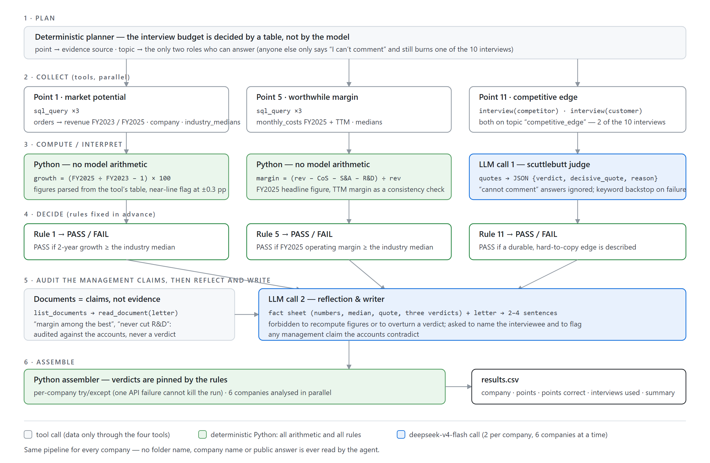

# FTEC5660 Homework 3: Fisher's 15-Point Investment Agent

Build a LangChain agent that researches a company with tools and applies the
framework from Philip Fisher's *Common Stocks and Uncommon Profits* (Part One,
Chapter 3 "What to buy: the fifteen points to look for in a common stock", and
Chapter 4 "What to buy: applying this to your own needs"). You choose 3 of
Fisher's 15 points and decide yourself what PASS means for each. For every
company your agent gives a PASS/FAIL verdict on your 3 points and a short
summary.

The companies are fictional, so the model cannot answer from memory. Unlike a
pile of reports, the evidence is spread over three sources, and your agent has
to go and get it with tools, the way Fisher's "scuttlebutt" method sends an
investor to talk to customers, competitors, suppliers and staff.

## Data and tools

`public_test/` has one folder per company. Your code receives four tools per
company (built by the provided code in `hw3.py`):

| Tool | What it gives you |
| --- | --- |
| `list_documents()` | the company's six documents and their dates |
| `read_document(name)` | one document: the 2025 letter to shareholders, four earnings calls (Q3 2025 to Q2 2026) and a news file (July 2025 to July 2026) |
| `sql_query(query)` | one read-only SQLite query on the company's database; at most 50 rows come back, so use `SUM`, `GROUP BY` and `WHERE` |
| `interview(role, topic)` | what one person says about the company; at most **10 interviews per company** |

The documents are what management says. Management's own claims (such as "we
have never cut research" or "our people are our greatest strength") are not
evidence on their own: check them against the database and the interviews.

**Database tables** (amounts in USD thousands; dates `YYYY-MM-DD`, months
`YYYY-MM`, quarters like `2025Q3`; the fiscal year is the calendar year):

| Table | Columns |
| --- | --- |
| `company` | name, industry |
| `industry_medians` | industry, revenue_growth_2y_pct, new_product_share_pct, new_product_sales_per_rd, operating_margin_pct (one row per industry; use the row for the company's own industry) |
| `orders` | order_id, order_date, product, customer, amount, note (about 3,000 to 4,000 orders from January 2023 to June 2026; revenue is the sum of order amounts) |
| `products` | product, launch_date |
| `monthly_costs` | month, cost_of_sales, selling_admin, research_development |
| `quarterly_cash` | quarter, operating_cash_flow, capex, cash_end |
| `capex_plan` | year, planned_capex (2026 to 2028) |
| `returns` | month, units_shipped, units_returned |
| `insider_trades` | trade_date, person, title, side (`buy` or `sell`), shares, price |

**Terms used in the data.**

| Term | Meaning |
| --- | --- |
| FY2025 | Fiscal year 2025. Here the fiscal year is the calendar year, so FY2025 is January to December 2025. |
| Quarter | Three months of the year: Q1 is January to March, Q2 April to June, Q3 July to September and Q4 October to December. The database writes `2025Q3`; the documents write "third quarter 2025". |
| Amounts | The database is in **USD thousands** (676,100 means US$676.1 million). The documents use USD millions. |
| Revenue | Money from sales: the sum of `amount` in `orders`. |
| Cost of sales | The cost of making the products that were sold. |
| Selling and admin | The cost of selling and of running the company (sales staff, offices, management). |
| R&D | Research and development spending, mainly on new products. |
| Operating margin | Operating profit as a share of revenue: (revenue − cost of sales − selling and admin − R&D) ÷ revenue. |
| Operating cash flow | Cash that the day-to-day business brings in during a quarter. |
| Cash at the end of a quarter | The cash the company holds on the last day of that quarter (`cash_end`). |
| Capex | Capital expenditure: spending on factories, machines and other long-term assets. `capex_plan` holds the planned capex for 2026 to 2028. |
| Return rate | Units returned ÷ units shipped, from the `returns` table. |
| Industry median | The middle value for companies in the same industry, from `industry_medians`. |
| Insider | A director or senior manager of the company. `insider_trades` lists the shares they bought (`buy`) or sold (`sell`). |
| Earnings call | A meeting each quarter where management presents the quarter's results to investors. Each call quotes that quarter's revenue. |

**Interviews.** Roles: `customer`, `current_employee`, `former_employee`,
`competitor`, `supplier`. Topics: `sales_team`, `working_conditions`,
`top_management`, `decision_making`, `competitive_edge`. Only some people know
about each topic; the others say they can't comment, and that answer still
uses up one interview.

| Topic | Who knows about it |
| --- | --- |
| `sales_team` | customer, competitor |
| `working_conditions` | current_employee, former_employee |
| `top_management` | former_employee, supplier |
| `decision_making` | supplier, customer |
| `competitive_edge` | competitor, customer |

People who know about a topic always agree with each other, so one good answer
is enough.

## Choose your 3 points and your rules

Pick any 3 of Fisher's 15 points and write them in `CHOSEN_POINTS` near the
top of `hw3.py`, e.g. `CHOSEN_POINTS = [1, 7, 15]`. The full questions are in
`FISHER_POINTS` in `hw3.py` and in the book.

| # | Fisher's point | Where the evidence is |
| --- | --- | --- |
| 1 | Market potential for sales growth | database |
| 2 | New products as current lines mature | database |
| 3 | Effective research and development | database |
| 4 | Above-average sales organization | interviews (`sales_team`) |
| 5 | Worthwhile profit margin | database |
| 6 | Maintaining or improving margins | database |
| 7 | Labour and personnel relations | interviews (`working_conditions`) |
| 8 | Executive relations | interviews (`top_management`) |
| 9 | Depth of management | interviews (`decision_making`) |
| 10 | Cost analysis and accounting controls | earnings calls, checked against the database |
| 11 | Advantage over competitors | interviews (`competitive_edge`) |
| 12 | Long-range outlook on profits | database |
| 13 | Growth without dilutive equity financing | database |
| 14 | Management talks freely about troubles | earnings calls, checked against the database |
| 15 | Management of unquestionable integrity | news file, checked against the database |

For each of your points, **you design the rule**: which evidence to use, what
to compute or whom to ask, and where the line between PASS and FAIL lies. PASS
means the company looks favourable on that point, as Fisher would see it.

We grade your verdicts against our own answer key. It uses one fixed rule per
point, which we do not publish, and the data never puts a company close to
the line of that rule, so a sensible reading of Fisher usually gives the same
answer. **Test your rules on the public answers**:
`public_test/ground_truth.json` gives the expected verdict on all 15 points
for each of the 20 public companies, and every point fails in 6 of them. If
your rule disagrees with the public answers, rethink it.

**Tip: calculate with tools, not in your head.** Do every sum, ratio and
comparison in SQL or Python, including the number of days between two dates
(SQLite's `julianday()` gives a date as a number of days).

## Student task

Fill in the three places in `hw3.py` marked `### YOUR CODE HERE`. You may add
imports, constants and helper functions above them, but do not change the
provided code below them:

- `CHOSEN_POINTS` lists your 3 points.
- `build_agent()` creates your model and anything else you need once.
- `analyze_companies(agent, companies)` receives
  `{company_folder: [list_documents, read_document, sql_query, interview]}`
  and returns, for every company,
  `{"points": {1: "PASS", 7: "FAIL", 15: "PASS"}, "summary": "..."}` (here with
  `CHOSEN_POINTS = [1, 7, 15]`).

Use the course techniques that fit your points: tool use for the database and
the interviews, planning which interviews to spend, routing each point to the
right source, prompt chaining, parallel calls, reflection to check your
answers, or a combination. Your code must read company data **only through
the four tools**; do not open `company.db` or `interviews.dat` yourself. Do
not hard-code folder names, company names or the public answers.

## Setup and public test

```bash
python3 -m venv .venv
source .venv/bin/activate
pip install -r requirements.txt
echo "DEEPSEEK_API_KEY=your_key_here" > .env
python3 hw3.py --data-folder public_test
```

Use your own DeepSeek API key (from https://platform.deepseek.com). The
required model is `deepseek-v4-flash`. We grade with our own key, so never put
a key in your code; `.env` must stay out of git.

The program creates `results.csv` with the columns `company`, `points`,
`points_correct`, `point_errors`, `interviews_used` and `summary`, and prints
the point score on your 3 points (the percentage after "balanced"). The point
score is the average of two shares: the share of truly passing verdicts that
you marked PASS and the share of truly failing verdicts that you marked FAIL.
For example, 90% and 60% give (90% + 60%) / 2 = 75%, and marking every point
PASS gives (100% + 0%) / 2 = 50%. Once `CHOSEN_POINTS` is set, the starter
runs before you add any API code (it returns no verdicts, so it scores 0%).

`public_test/ground_truth.json` gives the expected verdicts on all 15 points
for each public company. Grading uses a private set of about 20 unseen
companies with the same tools and the same answer key rules, but different
names and wording, and scores your 3 points only.

## Homework 3 solution:

Author: Veiv-cuhk · Code: `hw3.py` (`CHOSEN_POINTS = [1, 5, 11]`) · Runs:
`python3 hw3.py --data-folder public_test`

### My 3 points and rules

I chose one point per evidence source the homework gives me — database,
interviews, and documents-as-claims — so that the agent has to route, not just
query one table. All three rules are fixed *before* the agent runs, so the
model never decides where the PASS/FAIL line is.

**Point 1 — market potential for sales growth (database).** Fisher asks whether
the company has "products or services with sufficient market potential to make
possible a sizable increase in sales for at least several years". I picked this
point because Fisher calls market potential the first thing to look for, and
the database holds exactly the quantity that answers it.

> **PASS rule:** two-year revenue growth, FY2025 revenue ÷ FY2023 revenue − 1
> (revenue = `SUM(amount)` in `orders`), is **at least** the industry median
> `revenue_growth_2y_pct` for the company's own industry. Evidence: three
> `sql_query` calls (revenue by year, `company`, `industry_medians`).

**Point 5 — worthwhile profit margin (database).** Fisher: "if profit margins
do not stand out from those of competitors, a company is not likely to be an
outstanding investment". "Worthwhile" has to mean something comparable, so I
benchmark against the industry rather than against a fixed percentage or the
company's own past: the same margin can be excellent in food ingredients and
poor in medical devices.

> **PASS rule:** FY2025 operating margin, (revenue − cost of sales − selling
> and admin − R&D) ÷ revenue, is **at least** the industry median
> `operating_margin_pct`. Evidence: `sql_query` on `monthly_costs` (FY2025),
> `orders` and `industry_medians`. A trailing-twelve-month margin is computed
> as a consistency check and quoted in the summary.

**Point 11 — competitive edge peculiar to the industry (interviews).** Fisher's
point 11 asks for "other aspects of the business… which will give the investor
important clues as to how outstanding the company may be in relation to its
competition" — his argument that a worthwhile margin is only safe if something
defends it. This cannot be read off a table; it lives in what customers and
competitors say, which is exactly Fisher's "scuttlebutt".

> **PASS rule:** independent interviewees describe a durable advantage a rival
> cannot copy quickly (switching costs, proprietary know-how, installed base,
> performance leadership, customers who tried a rival and came back). FAIL if
> the product is described as a commodity bought on price. Evidence: exactly
> two interviews — `interview("competitor", "competitive_edge")` and
> `interview("customer", "competitive_edge")` — because Section 3.3 says only
> those two roles know the topic, and anyone else's "I can't comment" still
> costs one of the 10 interviews.

The documents are never evidence for a verdict. The 2025 letter to
shareholders is read for every company and used the way the homework suggests
management claims should be used: audited against the accounts, with any
contradiction reported in the summary. (For example, Hollins' letter claims a
59.4% gross margin "among the best in our industry" — the database gives
59.4% to the decimal, and its planned USD 238.0m of 2026–28 capex matches
`capex_plan` exactly.)

### Design



The agent is a fixed five-stage pipeline that runs once per company (20
companies, six at a time, about 50 seconds for the whole public set). A
**deterministic planner** routes each point to its source and fixes the
interview plan from the topic→role table, so the 10-interview budget can never
be wasted on someone who "cannot comment" — delegating that to the model would
add a failure mode without adding information. The **collect** stage pulls
facts only through the four LangChain tools (`sql_query`, `interview`,
`list_documents`, `read_document`). The **compute** stage does every sum,
ratio and comparison in Python — the homework's tip that model arithmetic
causes wrong verdicts is taken literally, so `deepseek-v4-flash` (two calls
per company) is only asked to *judge* and to *write*: call 1 is the
scuttlebutt judge, which turns the two interview quotes into
`{"verdict", "decisive_quote", "reason"}` JSON under the point-11 rule (with a
keyword backstop and retries if the call fails); call 2 is a
reflection-and-writer step that receives a fact sheet of already-computed
numbers plus the shareholder letter, is forbidden to recompute figures or
overturn a verdict, and produces the 2–4 sentence summary while flagging any
management claim the accounts contradict. Finally the **assembler** pins the
verdicts (rules, not prose), wraps each company in its own try/except so one
API failure cannot crash the run, and writes the `results.csv` row. Nothing
company-specific is hard-coded: folder names, industries and answers all come
from the tools at run time.

### Results

On `public_test` (20 companies) the agent scores **60/60 verdicts correct —
balanced point accuracy 100%** on points 1, 5 and 11, using 2 of the 10
interviews per company. The run was repeated three times end-to-end (the
grading protocol) and scored 100% each time, with identical verdicts.

Companies where my verdicts disagree with the public answers: **none**. The
public data never puts a company near the rule lines, which matches the
homework's description of the answer key: growth sits either clearly above or
clearly below the industry median (e.g. 27.9% vs 20.1% for
`copperfield_technologies`, 8.0% vs 11.5% for `cobalt_holdings`), and the
margin gaps are of the same size. The only place discretion is left to the
model is the point-11 reading of the interview quotes, and there the public
interviews are deliberately unambiguous ("nothing they make is hard to copy;
it is a price fight" against "their installed base and know-how are hard to
copy; we have tried for years"). `results.csv` in this repo is the output of
the last full run.
